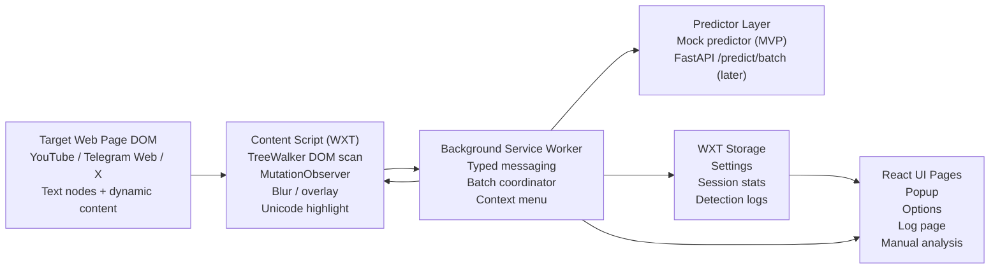

# Extension MVP Architecture

This document defines the browser extension MVP architecture for the thesis prototype. Keep implementation changes aligned with this file.

## MVP Goal

The MVP must demonstrate that the extension can scan page text in real time, detect judol-like content, blur or warn on detected text, highlight suspicious Unicode, and store useful evidence for demo and evaluation.

## System Flow

```text
Target page DOM
  -> content script scans text nodes
  -> content script sends batch prediction request
  -> background service worker runs mock predictor or calls API
  -> background stores stats/logs
  -> content script applies blur, overlay, and Unicode highlight
  -> React popup/log/options read state from storage
```

## Architecture Diagram



React owns extension UI. Web APIs handle third-party page DOM.

## Components

### Content Script

Responsibilities:

- collect visible text candidates with DOM APIs such as `TreeWalker`
- ignore unsafe or irrelevant elements such as `script`, `style`, `input`, and `textarea`
- watch new content with `MutationObserver`
- send prediction batches to background
- apply blur/overlay to detected judol text
- highlight suspicious Unicode spans
- avoid broad `innerHTML` rewrites and destructive DOM changes

Keep only technical state here, such as processed node IDs, scan queue, and pending batch state.

EXT-006 keeps the content script extraction-only: it may create typed scan batch messages, but it must not write storage, run prediction directly, or modify page DOM. Background coordination starts in EXT-007 and overlay mutations start in EXT-008.

### Background Service Worker

Responsibilities:

- receive `prediction:batch` and `prediction:manual` messages
- call the mock predictor first, then later FastAPI `/predict/batch`
- save detection logs and session stats
- expose settings/log data to React pages
- register context menu actions for manual analysis

The predictor boundary must be swappable. UI and content scripts should not know whether results came from mock logic or FastAPI.

EXT-007 implements the first background coordinator: it receives typed scan batches, runs the mock predictor, updates session stats and bounded detection logs, and returns batch prediction responses. It does not apply page overlays; content-script DOM mutation starts in EXT-008.

### React UI

Use React for extension-owned pages:

- popup: live status, counters, recent detections, toggles, and navigation
- options: API endpoint, mode, confidence threshold, platform scope, censor mode
- log page: searchable and filterable detection history
- manual analysis: selected text preview, label, confidence, terms, and Unicode breakdown

Do not use React as the engine for scanning third-party page DOM.

## Prediction Contract

Use this shape as the initial internal contract:

```ts
export type PredictionRequest = {
  items: Array<{
    id: string
    text: string
    sourceUrl: string
  }>
}

export type PredictionResult = {
  id: string
  label: "judol" | "non_judol"
  confidence: number
  action: "blur" | "none"
  matchedTerms: string[]
  unicodeSpans: Array<{
    start: number
    end: number
    reason: "homoglyph" | "invisible" | "symbol" | "unknown"
  }>
}
```

Keep shared types in `apps/browser-extension/src/types/`.

## Message Names

Use typed wrappers in `src/messaging/`. Avoid ad hoc string literals.

```text
prediction:batch
prediction:manual
settings:get
settings:update
stats:get
logs:add
logs:list
logs:clear
```

## Storage Model

Use WXT storage utilities. Suggested keys:

```text
settings:autoBlur
settings:highlightUnicode
settings:confidenceThreshold
settings:apiEndpoint
settings:predictionMode
settings:censorMode
stats:session
logs:detections
```

Detection logs should be bounded and clearable. Store snippets and metadata, not full private page histories.

## MVP Feature Boundaries

Required for MVP:

- WXT + React popup shell
- typed prediction contract
- mock predictor
- DOM scanner
- batch messaging
- blur/overlay action
- Unicode highlight
- MutationObserver
- basic storage-backed stats

Strong demo additions:

- detection log page
- options page
- manual analysis via context menu
- local simulation page for deterministic testing

Out of scope for MVP:

- user accounts
- cloud sync
- Chrome Web Store publishing
- running the ML model inside the browser
- large analytics dashboard
- committing raw browsing logs

## Implementation Order

1. Scaffold WXT + React + TypeScript.
2. Add shared types and mock predictor.
3. Build popup with mock stats.
4. Implement DOM scanner and text candidate extraction.
5. Add batch prediction messaging.
6. Add blur/overlay and Unicode highlight.
7. Add MutationObserver for realtime content.
8. Persist session stats and bounded logs.
9. Add log page and options page.
10. Add manual analysis context menu.
11. Integrate FastAPI `/predict/batch`.

## Evaluation Hooks

The architecture should support thesis evaluation by making these values observable:

- scanned text count
- detected judol count
- Unicode suspicious count
- detection success rate on simulation pages
- false positive cases from logs
- API response time when FastAPI is integrated
- end-to-end scan-to-blur time
