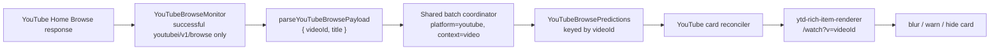

# YouTube Home Browse Card Detection Design

## Goal

On the YouTube Home feed, JudolLens captures successful `youtubei/v1/browse` responses, extracts regular-video `{ id, text }` records, predicts them through the existing batch contract, and applies the configured censor action only to the matching rendered video card.

This is the YouTube counterpart to the approved X timeline ID-reconciliation flow. It does not add API endpoints or alter the OpenAPI response shape.

## Scope

Included:

- Capture `browse` response bodies through `chrome.debugger` only while a YouTube content script is subscribed.
- Extract regular Home-feed video IDs and titles from the Browse payload.
- Send extracted records through the existing mock/API prediction coordinator with `source.platform = "youtube"` and `context.kind = "video"`.
- Reconcile positive keyed results against rendered regular-video Home cards and apply `blur`, `warn`, or `hide` to the whole card.
- Reconcile again when YouTube dynamically mounts or remounts cards.

Excluded:

- Shorts, advertisements, in-feed ads, continuation/loading renderers, search, watch, channel, and subscription pages.
- DOM TreeWalker scanning of YouTube Home card titles.
- New FastAPI routes, OpenAPI schemas, extension settings, persistent storage keys, or prediction response types.
- Storage of Browse payloads, video titles, thumbnails, channel metadata, or browsing history outside the existing bounded detection-evidence policy.

## Architecture

The implementation adds three YouTube-specific units instead of generalizing the verified X monitor:

1. `parseYouTubeBrowsePayload(payload)` owns the unstable YouTube response-tree boundary.
2. `YouTubeBrowseMonitor` owns per-tab Chrome Debugger response capture and bounded dispatch deduplication.
3. `createYouTubeBrowseReconciler(root)` owns in-memory positive-result caching and DOM card matching.

The background coordinator, mock/API predictor selection, API gateway, storage, prediction metadata, logging policy, settings, and debugger transport remain shared.

## Response Capture

The content script subscribes only on YouTube Home and unsubscribes on `pagehide`. The background monitor attaches with Chrome Debugger Protocol `1.3`, enables `Network`, and observes one tab at a time.

A response is eligible only when all conditions hold:

- the subscribing tab received `Network.responseReceived`;
- HTTP status is exactly `200`;
- URL host is `youtube.com` or a subdomain of `youtube.com`;
- URL pathname is exactly `/youtubei/v1/browse`.

The monitor reads an eligible body only after `Network.loadingFinished`; it removes pending IDs on `Network.loadingFailed`. It supports CDP base64 response bodies. Invalid JSON, failed decode, unavailable response bodies, and unrecognized payloads are ignored without generating a prediction or a non-judol result. A later eligible response remains processable.

Subscription is idempotent. Unsubscribe during `attach` or `Network.enable` cancellation detaches safely. Tab removal also unsubscribes. Late events after unsubscribe and stale explicit-detach events are inert, following the verified X monitor lifecycle policy.

## Payload Extraction

The parser accepts only the Home Browse route:

`contents.twoColumnBrowseResultsRenderer.tabs[]`
`→ selected tabRenderer.content.richGridRenderer.contents[]`
`→ richItemRenderer.content.lockupViewModel`

For every candidate it accepts only:

- `contentType = "LOCKUP_CONTENT_TYPE_VIDEO"` when present;
- a non-empty trimmed `contentId`;
- a non-empty trimmed title at `metadata.lockupMetadataViewModel.title.content`.

It returns `{ id: contentId, text: title }`. It deduplicates by video ID within one response, preserving the first valid item.

`adSlotRenderer`, `shortsLockupViewModel`, `inFeedAdLayoutRenderer`, malformed items, empty fields, unselected/non-Home trees, and unknown renderers yield no prediction records. The parser is fail-closed: a YouTube schema change must leave cards untouched rather than incorrectly censoring another card.

## Prediction and Data Boundary

Each extracted item follows the generic `handleScanBatch` route with:

- `source.platform: "youtube"`;
- `context.kind: "video"`;
- `context.selectorHint: "ytd-rich-item-renderer"`;
- `context.visible: true`;
- `context.languageHint: "id"`.

The shared coordinator supplies mock/API mode selection, stored threshold, stats, bounded detection logs, model metadata, and terminal API-error behavior. Before returning results to the tab, positive results receive the current `censorMode`, as in the X timeline flow.

The monitor retains at most 500 dispatched video IDs per tab. It discards raw response bodies immediately after parsing. The reconciler retains at most 100 positive `{ id, riskLevel, action }` results in memory and does not write titles or payloads to storage.

## Card Reconciliation and Actions

The content script must not run the generic DOM text scan for this YouTube Home mode. It receives keyed Browse prediction results through a typed runtime message and passes them to the YouTube reconciler.

The reconciler finds only `ytd-rich-item-renderer` cards with a descendant anchor whose relative or absolute URL resolves to `/watch?v=<videoId>`. A positive result applies only when the extracted `videoId` exactly matches that query value.

Actions alter the complete matching card:

- `blur`: one pointer-transparent full-card overlay and label;
- `warn`: one compact, pointer-transparent label while preserving readable content;
- `hide`: remove only the matching card.

Overlay application is idempotent. Unrelated cards, cards with missing/invalid watch IDs, Shorts (`/shorts/<id>`), advertisements, and results without a rendered matching card remain unchanged. A `MutationObserver` observes child-list changes and re-runs reconciliation so delayed or remounted matching cards receive the cached decision.

A virtualized card that remounts after its 100-result decision leaves the in-memory cache can become visible until a new eligible Browse response supplies the same ID. This privacy boundary is intentional.

## Verification

1. Parser unit tests use the redacted `configs/yt_browse.json` fixture and prove extraction of `mENZViPTNYc` with its title; they reject ads, Shorts, malformed/empty records, duplicates, and invalid or unselected roots.
2. Monitor unit tests prove successful eligible Browse capture, host/path/status rejection, response-failure cleanup, base64 handling, cross-response ID deduplication, unsubscription, setup cancellation, and late-event lifecycle safety.
3. Coordinator tests prove YouTube source metadata, `video` item context, `blur`/`warn`/`hide` setting action selection, and the existing terminal-API-error no-persistence rule.
4. Reconciler unit tests prove exact `/watch?v=<id>` matching, whole-card blur/warn/hide, no change for unrelated cards or Shorts, idempotence, and remounted-card reconciliation.
5. A loaded-extension Playwright fixture with regular Home cards proves runtime delivery changes only matching cards for all three actions and saves a screenshot to `docs/extension/screenshots/`.
6. Final gates run focused Vitest, `pnpm test:run`, `pnpm compile`, `pnpm build`, the focused Playwright scenario, `pnpm test:e2e`, and repository `init.ps1`.

## Risks

- YouTube can change its internal Browse tree or custom-element structure. The narrow parser and selectors fail closed.
- Chrome shows debugging state and DevTools can conflict with `chrome.debugger`; this is the accepted mechanism selected for both X and YouTube response capture.
- Dynamic Home virtualization may outlive the reconciler cache; no durable browsing-history cache is introduced to cover that case.
